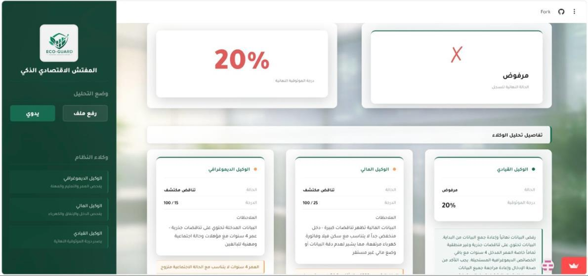
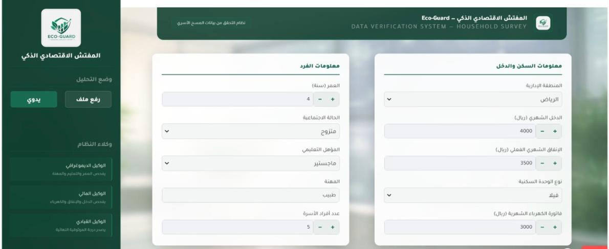
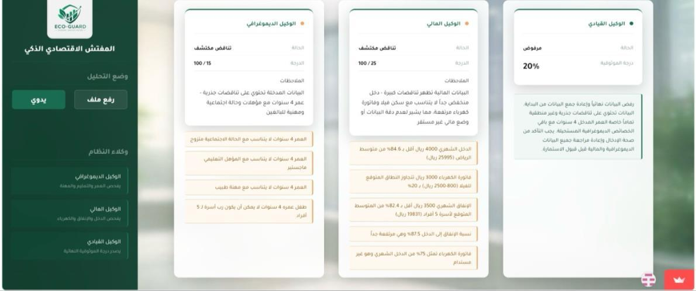
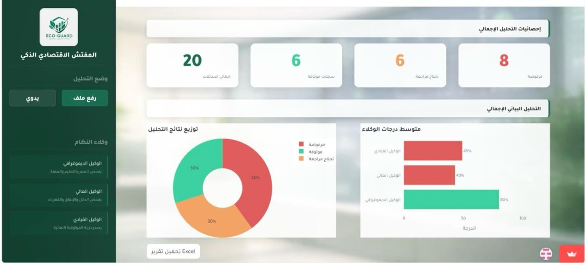

<div align="center">


# Eco-Guard — Intelligent Economic Inspector

**An AI-powered multi-agent system that verifies household survey data and flags inconsistent or suspicious records.**


-D97757)


### [🚀 Try the live demo](https://eco-guard-va7gbqxonc2o53qwv27jrk.streamlit.app/)

[Report (PDF)](docs/EcoGuard_Report.pdf) · [Presentation (PDF)](docs/EcoGuard_Presentation.pdf)

</div>

---

## Overview

National statistics authorities such as **GASTAT** (General Authority for Statistics, Saudi Arabia) run large household surveys that feed national planning. Checking every record by hand is slow and error-prone.

**Eco-Guard** automates this quality check. Each survey record is reviewed by three specialized AI agents, and the system returns a **trust score from 0 to 100**, a final verdict, and a recommendation. Analysts use these to decide which records to accept, review, or reject.

<div align="center">

</div>

## How it works

| Agent | What it checks |
|---|---|
| 🧑‍🤝‍🧑 **Demographic Agent** | Whether age, marital status, education, occupation, and family size are logically consistent (for example, a 3-year-old holding a doctorate). |
| 💰 **Financial Agent** | Income, expenses, and electricity bill against GASTAT regional benchmarks and housing type. |
| 🧭 **Manager Agent** | Combines both reports into a final trust score and an actionable recommendation. |

The Demographic and Financial agents run **in parallel**, which cuts analysis time by about 60%. Personal fields such as name, ID, and phone are removed before any data is sent to the AI.

```
Input (form / CSV) ─► Preprocess & anonymize ─► ┌ Demographic Agent ┐
                                                 │                   ├─► Manager Agent ─► Trust score + dashboard + Excel
                                                 └ Financial Agent   ┘
```

| Trust score | Verdict |
|---|---|
| ≥ 75 | ✅ Trusted |
| 50 – 74 | ⚠️ Needs review |
| < 50 | ❌ Rejected |

## Features

- **Arabic RTL dashboard** using the Tajawal font and a glassmorphism design
- **Role-based login** (Field Researcher / Administrator) with PBKDF2 password hashing and account lockout
- **Manual analysis** of a single record, with a breakdown from each agent
- **Batch CSV analysis** with parallel processing and live progress
- **Interactive Plotly charts**: trust-score gauge, verdict distribution, and average score per agent
- **Color-coded Excel export** (green / orange / red)
- **Admin panel** for user management and the audit log

## Screenshots

| Login | Manual input |
|---|---|
|  |  |

| Agent details | Batch analysis dashboard |
|---|---|
|  |  |

## Run it locally

You need **Python 3.12+** and an **[Anthropic API key](https://console.anthropic.com/)**.

```bash
git clone https://github.com/bushrall0/Eco-Guard.git
cd Eco-Guard/src
pip install -r requirements.txt

cp .env.example .env        # then put your ANTHROPIC_API_KEY in .env
streamlit run app.py
```

Open http://localhost:8501 and sign in as `eco`. The password comes from `ADMIN_PASSWORD` in `.env`. To test batch mode, upload [`sample_data/sample_records.csv`](sample_data/sample_records.csv).

### Optional: separate backend

The agents can also run behind a **FastAPI** backend with one endpoint per agent:

```bash
uvicorn api:app --port 8000                 # backend
API_BASE_URL=http://localhost:8000 streamlit run app.py   # frontend
```

| Endpoint | Description |
|---|---|
| `GET /health` | Health check |
| `POST /agent/demographic` | Demographic agent |
| `POST /agent/financial` | Financial agent |
| `POST /agent/manager` | Manager agent (final trust score) |
| `POST /analyze` | All three agents |

If `API_BASE_URL` is not set, the Streamlit app runs the agents directly. That means the whole project can be deployed as one app.

## Deploy (Streamlit Community Cloud, free)

1. Sign in at [share.streamlit.io](https://share.streamlit.io) with GitHub and click **Create app**.
2. Choose this repository, branch `main`, and main file `src/app.py`.
3. Under **Advanced settings → Secrets**, add:
   ```toml
   ANTHROPIC_API_KEY = "your_key"
   ADMIN_PASSWORD = "a_strong_password"
   ```
4. Click **Deploy**.

> 🔒 The API key is stored only in the hosting platform's secrets. It is never committed to the repository.

## Project structure

```
Eco-Guard/
├── src/
│   ├── app.py               # Streamlit dashboard (UI, auth, charts, export)
│   ├── api.py               # FastAPI backend (one endpoint per agent)
│   ├── api_client.py        # Calls the backend, or runs the agents directly
│   ├── agents.py            # Multi-agent logic, anonymization, JSON parsing
│   ├── prompts.py           # Prompts for each agent
│   ├── llm_service.py       # Claude API wrapper
│   ├── database.py          # SQLite users + audit log (PBKDF2)
│   ├── utils.py             # CSV handling, Excel export
│   └── reference_data.json  # GASTAT regional benchmarks
├── sample_data/             # Example CSV for batch analysis
└── docs/                    # Report, presentation, screenshots
```

## Team — Groupe 02

| Name | Role |
|---|---|
| Haneen Alshuwayqi | Team Leader & Backend Developer |
| Sumaiya Balatif | Frontend Developer |
| Taif Alshehri | AI & Agents Engineer |
| Munirah Almousa | Data Analyst |
| **Bushra Almughirah** | Documentation & Visualization (report, presentation, Plotly charts, Excel export) |

Built for **SW 413 – Data Exploration and Visualization** at Princess Nourah bint Abdulrahman University (2nd Semester 2026), supervised by Dr. Motasem Alsawadi.
The original team repository is [Haneen-Alshuwayqi/Eco-Guard](https://github.com/Haneen-Alshuwayqi/Eco-Guard).

---

<div dir="rtl">

### نبذة بالعربي

**Eco-Guard (المفتش الاقتصادي الذكي)** نظام ذكاء اصطناعي متعدد الوكلاء للتحقق من بيانات المسح الأسري. يحلل كل سجل ثلاثة وكلاء: الوكيل الديموغرافي والوكيل المالي والوكيل القيادي، ثم يصدر النظام درجة موثوقية من 0 إلى 100 مع توصية. هذا يساعد المحللين على اكتشاف البيانات غير المنطقية أو المشبوهة بسرعة. للنظام واجهة عربية كاملة، ويدعم الإدخال اليدوي وتحليل ملفات CSV وتصدير النتائج إلى Excel.

</div>
